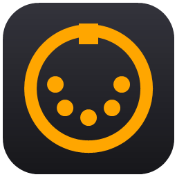

<p align="center"></p>

# ME-25 MIDI

Transforma os footswitches da pedaleira **BOSS ME-25** em mensagens **MIDI** no Windows,
para controlar DAWs e plugins (MIDI Learn) usando a própria pedaleira.

| Switch da ME-25 | MIDI enviado (padrão, canal 1) |
|---|---|
| **MEMORY ▼** (desce patch) | **CC 20** — 127 e logo depois 0 (toque) |
| **MEMORY ▲** (sobe patch) | **CC 21** — 127 e logo depois 0 (toque) |
| **SOLO** | **CC 22** — 127 liga / 0 desliga |
| *(opcional)* | **Program Change** com o número do patch (0–59) |

Canal e números de CC são configuráveis na janela.

## Por que isso existe

A ME-25 tem porta USB com MIDI, mas **não envia nenhuma mensagem MIDI comum** quando você pisa
nos switches — a porta serve só para o editor (BOSS TONE STUDIO / Librarian) ler e gravar patches
por SysEx. O ME-25 MIDI usa esse mesmo canal: pergunta à pedaleira qual é o patch atual ~15 vezes
por segundo e converte as mudanças em CC. Detalhes em [docs/PROTOCOLO.md](docs/PROTOCOLO.md).

## Requisitos

- Windows 10/11 64 bits
- **Driver da ME-25** (BOSS, versão 1.0.1 para Windows 10/11) — [boss.info › ME-25 › Updates & Drivers](https://www.boss.info/br/support/by_product/me-25/updates_drivers/)
- **[loopMIDI](https://www.tobias-erichsen.de/software/loopmidi.html)** (Tobias Erichsen) instalado — o app usa o driver dele
  para criar sozinho a porta virtual **"ME-25 MIDI"**. Não é preciso criar porta no loopMIDI.
  *(Alternativa: escolher qualquer outra porta MIDI de saída na janela.)*

## Instalação e uso

1. Baixe o `ME25MIDI.exe` na página de [Releases](../../releases) (ou compile — veja abaixo).
2. Conecte a ME-25 no USB e **feche o BOSS TONE STUDIO** (ele ocupa a porta da pedaleira).
3. Abra o `ME25MIDI.exe`. O status fica verde ("Conectada") em poucos segundos.
4. No DAW, ative a entrada MIDI **"ME-25 MIDI"** e use o MIDI Learn nos parâmetros que quiser.

Recursos da janela:
- LEDs de MEMORY ▼, MEMORY ▲ e SOLO
- Escolha da porta de saída, canal, CCs e Program Change (salvos em `%APPDATA%\ME25MIDI\settings.ini`)
- Minimiza para a bandeja do relógio; opção de iniciar minimizado
- Reconecta sozinho se a ME-25 for desligada/religada

## Limitações

- **Pedal de expressão:** a ME-25 **não expõe a posição do pedal** pelo USB (testado com PEDAL FX
  ligado e desligado). Só o liga/desliga do PEDAL FX aparece nos dados.
- **Latência:** ~50–150 ms (polling). Ótimo para trocar cenas e ligar efeitos; não serve para
  nada que precise de precisão rítmica.
- **Segurar o MEMORY** faz a ME-25 rolar vários patches, e cada passo gera um CC.
- O SOLO é guardado por patch na ME-25; quando a troca de patch muda o estado do SOLO, o app
  **não** envia CC de SOLO (só os switches geram mensagens).
- Não pode rodar junto com o BOSS TONE STUDIO.

## Compilar

Não precisa de Visual Studio nem SDK: usa o compilador C# do .NET Framework 4 que já vem no Windows.

```bat
build.cmd
```

Gera `bin\ME25MIDI.exe`. O ícone é gerado por `tools\make-icon.ps1` (saída em `assets\`).

## Estrutura

```
src/Program.cs           app WinForms (WinMM + teVirtualMIDI), arquivo único
assets/                  ícone (.ico e .png)
build.cmd                compilação
docs/PROTOCOLO.md        o que foi descoberto sobre o SysEx da ME-25
tools/
  midi-monitor.ps1       lista portas MIDI e mostra mensagens recebidas
  midi-sysex-probe.ps1   envia SysEx / faz polling e mostra diferenças byte a byte
  me25-bridge.ps1        versão de linha de comando da ponte (sem janela)
  make-icon.ps1          gera o ícone
```

Para usar os scripts PowerShell:

```powershell
powershell -ExecutionPolicy Bypass -File tools\midi-monitor.ps1 -Seconds 30
powershell -ExecutionPolicy Bypass -File tools\me25-bridge.ps1 -OutPort "loopMIDI" -ProgramChange
```

## Créditos e avisos

- A porta virtual usa o driver **teVirtualMIDI** de Tobias Erichsen, instalado junto com o loopMIDI.
  Ele não é distribuído neste repositório; consulte a licença do autor para uso comercial.
- BOSS e ME-25 são marcas da Roland Corporation. Projeto independente, sem afiliação com a Roland/BOSS.
- Licença: [MIT](LICENSE).
